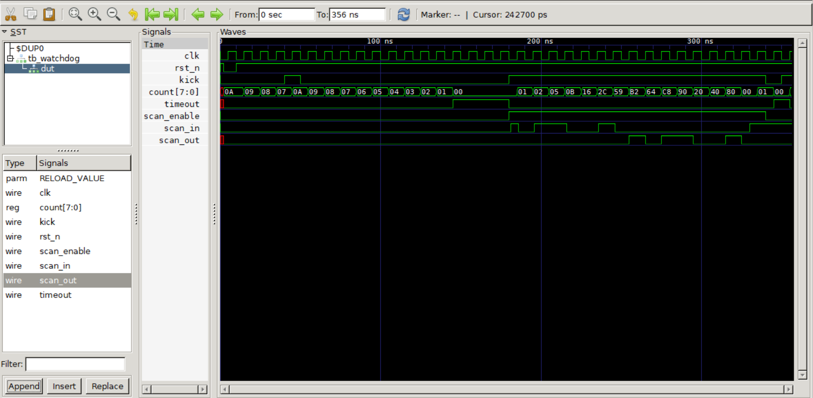

# MiniWatchdog

An 8-bit watchdog timer in Verilog-2001 with manual scan DFT through the counter register.

## Interface

| Signal | Kind | Width | Behavior |
| --- | --- | ---: | --- |
| `clk` | Input | 1 | Rising-edge clock for counting, reload, and scan shift. |
| `rst_n` | Input | 1 | Active-low asynchronous reset. Loads `RELOAD_VALUE` in either mode. |
| `kick` | Input | 1 | Reloads the count at the next rising edge in functional mode. |
| `scan_enable` | Input | 1 | Selects scan shift when high and functional mode when low. |
| `scan_in` | Input | 1 | Serial bit shifted into bit 0. |
| `scan_out` | Output | 1 | Current value of bit 7. |
| `timeout` | Output | 1 | High when the count is zero in functional mode. |
| `RELOAD_VALUE` | Parameter | 8 | Reset and kick reload value. Defaults to `8'd10`. |

## Architecture

```text
Reload / decrement / hold ──┐
                            ├─► [mux] ─► [8-bit counter] ─┬─► bit 7 ───────► scan_out
{count[6:0], scan_in} ──────┘                             └─► zero detect ─► timeout
```

In functional mode, a rising edge reloads the counter if `kick` is high. Otherwise the count decrements and holds at zero. With the default reload, ten rising edges without a kick bring the count to zero.

`scan_enable` selects the shift path and masks the zero detector output. Eight MSB-first shifts can load any count. Sampling `scan_out` before each shift reads the previous contents in the same order. Functional mode resumes from the value left in the register.

## Verification

The self-checking SystemVerilog testbench runs with Icarus Verilog (`-g2012`). All seven scenarios passed, covering reset, countdown, reload, timeout, saturation, a scan round-trip with `8'hB2`, and mode switching.

The GTKWave capture shows the count reload to `0A`, reach `00` at timeout, and take the value `B2` during scan.



## Synthesis

Yosys 0.52 generated 49 generic cells, including 8 flip-flops. The `check -assert` structural check and the zero-delay netlist simulation both passed.

## Run locally

Run these targets from the repository root with GNU Make and the matching tool on `PATH`.

```sh
make sim     # RTL simulation with Icarus Verilog
make lint    # RTL lint with Verilator
make synth   # Generic synthesis with Yosys
make gate    # Synthesize and simulate the netlist with the same testbench
```

On Windows, `run.bat` runs the RTL simulation with Icarus Verilog. Open `build/watchdog.vcd` in GTKWave.

The [RTL checks workflow](https://github.com/messak-amine/mini-watchdog-asic/actions/workflows/rtl.yml) runs these checks on Linux and publishes the synthesis log, cell stats, netlist, and waveforms as `watchdog-results`.
